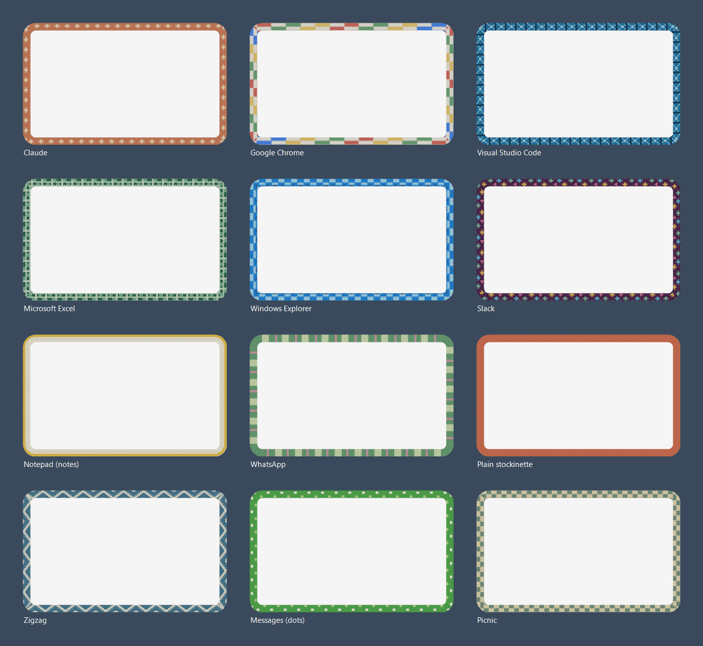
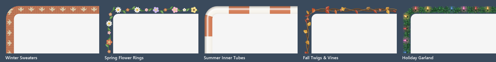

# Window Sweaters for Windows

A Windows port of [Window Sweaters for macOS](https://github.com/saragordic/window-sweaters) by
Sara Gordić: knitted borders for your windows, in colours inspired by your favourite apps. 🧶



*(Rendered by `WindowSweaters.exe --swatch docs/preview.png 1.25` — the same renderer the app uses.)*

## Run it

Needs Windows 10 or 11 (x64). The small build needs the
[.NET 9 Desktop Runtime](https://dotnet.microsoft.com/download/dotnet/9.0); the self-contained build doesn't.

```powershell
.\build.ps1                 # -> publish\WindowSweaters.exe (~300 KB)
.\build.ps1 -SelfContained  # bundles .NET, runs anywhere
```

Then run `publish\WindowSweaters.exe`. A yarn ball appears in the notification area (it may be
tucked under the `^` overflow arrow; drag it onto the taskbar to keep it visible).
No admin rights or accessibility permission are needed.

## Make yourself cosy

Click the yarn ball (left or right click) for the menu:

- **Show Sweater Borders** — pause or resume every sweater.
- **Season** — what your windows wear (see below), or **Follow the Calendar** to change with the
  months. **Twinkling Lights** animates the holiday garland.
- **Apps** — untick an app to leave it bare. **Turn Off for All Apps**, then tick a few, to
  sweater only the ones you like; apps you open later start off too. Choices survive a restart.
- **Pattern** — **By App** gives each app its own sweater. **Stockinette** and **Rib** are plain
  knitting in each app's colour. **Zigzag** gives everyone a matching cream zigzag in colours
  taken from their icons. Picnic Checks, Ribbon Stripes, Little Bows, Tiny Stars and Candy Stripes
  are shared patterns. Your own PNG charts appear under **Custom Patterns**.
- **Border Width** and **Stitch Size** — from Slim to Extra Wide, Chunky to Very Fine.
- **Your Colourways** — open the settings folder, edit `apps.conf`, reload.
- **Start with Windows** — adds or removes a per-user startup entry.

## Seasons

Sweaters are for winter. The rest of the year your windows can dress for the weather:



| Season | Outfit | With Follow the Calendar |
|---|---|---|
| Winter Sweaters | the knitted collection below | January and February |
| Spring Flower Rings | a leafy vine with daisies, pastels and flowers in the app's colour | March to May |
| Summer Inner Tubes | a glossy pool ring striped in the app's colour | June to August |
| Fall Twigs & Vines | twisted twigs, autumn leaves and berries in the app's colour | September to November |
| Holiday Garland | pine garland with C9 lights that slowly twinkle | December |

Every season keeps each app's own colour, so your `apps.conf` colourways carry through the year.
Winter is the default; **Follow the Calendar** is opt-in. The decorations show more detail at
**Border Width → Wide** or wider. The twinkling garland redraws only its lights, five times a second,
and uses about 2% of one CPU core; turn off **Twinkling Lights** for a still garland.

## The sweaters

All 37 hand-picked colourways from the macOS collection are here, matched by the app's
description (what Task Manager shows, e.g. *Google Chrome*, *Microsoft Excel*) or its `.exe`
name. Windows apps without a macOS twin borrow the closest sweater:

| Windows app | Wears |
|---|---|
| File Explorer | Finder's blue blocks |
| Windows Terminal, PowerShell, Command Prompt | Terminal's green stripes |
| Notepad | Notes' yellow cuff |
| Word, Excel, PowerPoint, Outlook (classic and new) | their Office sweaters |

Any other app borrows colours from its own icon, softened into yarn, with a zigzag, picnic or
twinkle pattern chosen from its name, exactly as on the Mac.

## Your own colourways

Settings live in `%APPDATA%\Window Sweaters\`:

```text
apps.conf      per-app rules
charts\        your own PNG charts (transparent = the app's yarn, opaque = that colour)
settings.json  menu choices
```

A rule looks like this — the name is a case-insensitive prefix of the app's description or exe name,
the longest match wins, and the chart is optional:

```text
Claude = #D58561 atelier-claude
msedge = #2C7CD6 picnic
```

Choose **Your Colourways → Reload Colourways** after editing.

## How it works

Each window that wears a sweater gets four click-through, per-pixel-alpha layered windows (one per
side) placed directly beneath it in z-order. They reach a little way *under* the window — the
"tuck" — so the knit never shows a gap while you drag. Window moves are followed through
WinEvent hooks; a move just repositions the strips, a resize redraws them from cached knit tiles.
Visible frame bounds and corner rounding come from DWM, and sizes follow each monitor's DPI.
Seasonal decorations are placed by arc length around the rounded ring, so they follow the corners;
they're drawn from cached sprites, and the garland keeps a copy of everything but its lights so a
twinkle only re-blits the bulbs.

Windows go without a sweater while maximized, full screen, minimized or on another virtual desktop.

## Differences from the macOS app

- The optional startup shell script (`sweatersrc`) and command-line style flags aren't ported.
- Unfocused-window dimming (off by default on the Mac) isn't exposed.
- Apps are keyed by `.exe` name rather than bundle identifier.
- Windows that draw their own translucent backdrops (acrylic) may show a hint of knit in the tuck.

## Developer aids

```powershell
WindowSweaters.exe --swatch out.png [scale] [season] [seconds]   # render samples to a PNG
WindowSweaters.exe --menu-test out.txt        # click through every menu style, dump the menu
WindowSweaters.exe --write-icon app.ico       # regenerate the icon
```

## Credits and license

Ported from [saragordic/window-sweaters](https://github.com/saragordic/window-sweaters), itself built
on [JankyBorders](https://github.com/FelixKratz/JankyBorders) by Felix Kratz. Released under
[GPL-3.0](LICENSE). See [NOTICE.md](NOTICE.md) for attribution.
